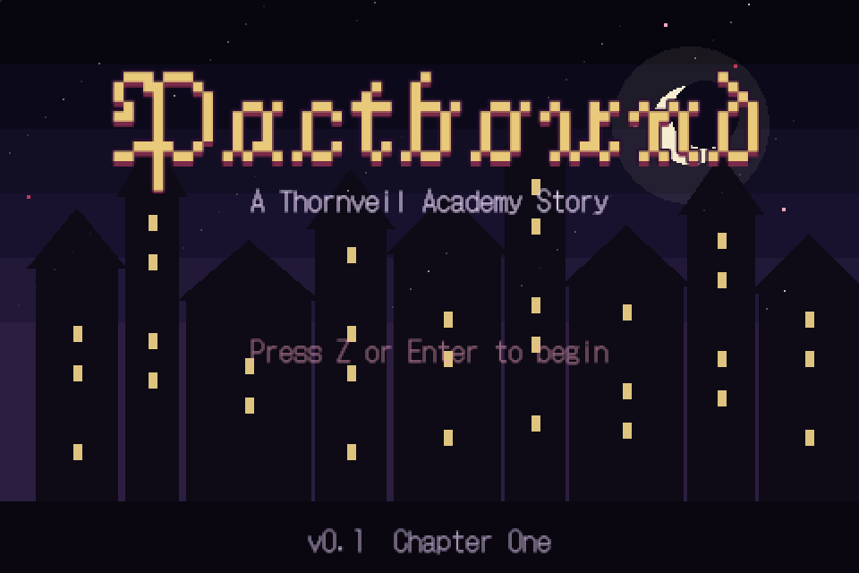
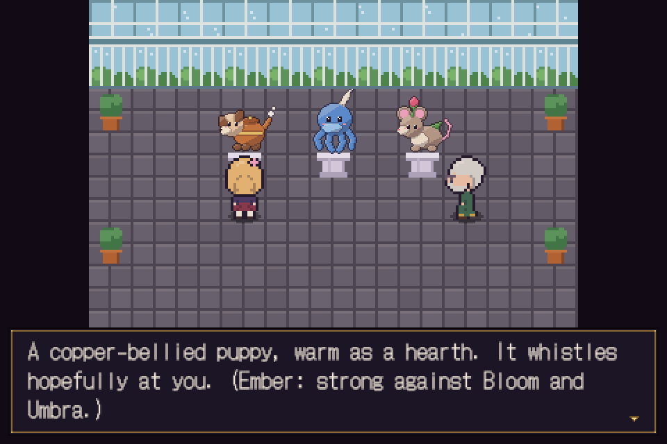
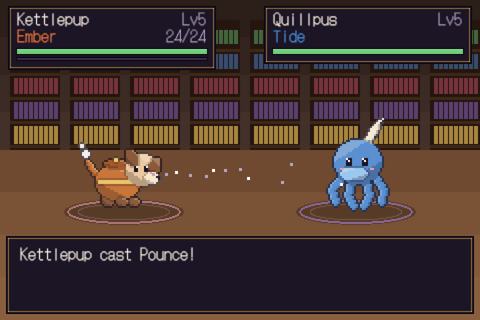
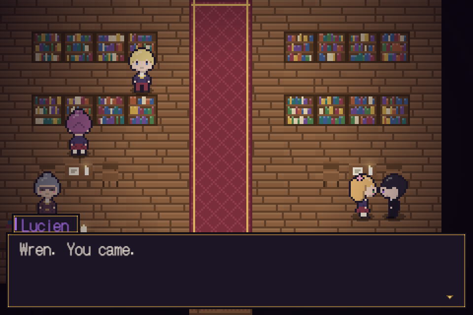
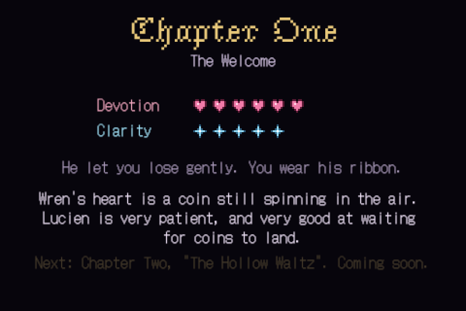

# Pactbound

*A Thornveil Academy Story.* A dark-romance creature-binding RPG for the browser.

You play **Wren Ashby**, a sweet, earnest scholarship girl whom wild familiars trust on sight. **Lucien Ravelle**,
the golden heir of the house that owns the academy, decides she is exactly what his family needs. Bind familiars,
duel students, explore Thornveil, and decide how far Wren falls for him and how clearly she sees him.



| | |
|---|---|
|  |  |
|  |  |

## What's in this version (v0.1, Chapter One)

- **Chapter One: "The Welcome"**, about 30–45 minutes: the arrival, choosing a tutelary familiar, the runaway
  Grimlet, the library, a moonlit duel with Lucien, and his epilogue. Choices raise two hidden meters,
  **Devotion** and **Clarity**, which colour his lines and the end-of-chapter card.
- **15 original familiars** (three starters that ascend at level 16), **35 spells** and **9 arcana** (types),
  including Umbra and Heart, which are each other's weakness.
- Turn-based duels: priority, stat stages, four status ailments, critical hits, experience, levelling,
  learning spells (and choosing one to forget), ascension, switching, items, fleeing.
- Binding wild familiars with Pact Sigils. Wren's *Heartbloom* gift makes every sigil 25% more likely to hold.
- Six academy maps, four optional student duels, a shop, pick-ups, a journal and a bestiary count.
- Saving to the browser, keyboard controls, and touch controls on phones (handheld layout in portrait).
- All art, music and sound are generated in code. There are no image or audio files.

## Running it

You need [Node.js](https://nodejs.org/) 20 or newer.

```bash
cd pactbound
```

```bash
npm install
```

```bash
npm run dev
```

Then open the address it prints (normally <http://localhost:5173>). To play on your phone, run
`npm run dev -- --host` and open the "Network" address on a phone on the same Wi-Fi.

| Command | What it does |
|---|---|
| `npm run dev` | Development server with hot reload |
| `npm test` | Unit tests (battle engine, formulas, data, maps, saves) |
| `npm run typecheck` | TypeScript type check |
| `npm run build` | Type check, then a production build in `dist/` |
| `npm run preview` | Serve the production build locally |

`dist/` is a static site with relative paths, so you can upload it to any static host (GitHub Pages,
Netlify, itch.io as an HTML game, and so on).

## Controls

| Action | Keyboard | Touch |
|---|---|---|
| Walk / move cursor | Arrow keys or WASD | D-pad |
| Talk, confirm | Z, Enter or Space | A |
| Back; hold to run | X, Backspace or Shift | B |
| Journal menu | Esc, C or Tab | MENU |

Touch controls appear automatically on phones and tablets. Add `?touch=1` (or `?touch=0`) to the address to
force them on or off.

## Project layout

```
pactbound/
├── docs/            STORY.md (story bible), DESIGN.md (rules and numbers), ARCHITECTURE.md (code guide)
├── src/
│   ├── battle/      Battle engine, formulas, AI. Pure TypeScript, no Phaser.
│   ├── core/        Familiars, game state, saving, RNG
│   ├── data/        Arcana, familiars, spells, items, trainers, cast
│   ├── gfx/         Procedural pixel art: characters, familiars, tiles, UI icons
│   ├── audio/       WebAudio synth and the chiptune tracks
│   ├── input/       Keyboard and touch controls
│   ├── scenes/      Phaser scenes: Title, World, UI, Battle, Menu, Ending
│   ├── story/       Chapter scripts and the script API
│   ├── ui/          Dialogue box, menus, party panel
│   └── world/       Maps, tiles, actors
├── tests/           Vitest unit tests
└── gallery.html     Dev-only page showing every generated sprite and map
```

See [docs/ARCHITECTURE.md](docs/ARCHITECTURE.md) for how to add familiars, spells, maps, characters and
story scenes.

## Tone

Pactbound is a dark romance. Lucien is charming, possessive and manipulative, and the game shows his tactics
without narrating them; the player may notice before Wren does. It stays at a teen rating: emotional
manipulation and menace, no explicit content. See [docs/STORY.md](docs/STORY.md).

## Credits and licences

- Built with [Phaser 4](https://phaser.io/) (MIT), [Vite](https://vite.dev/) (MIT) and
  [Vitest](https://vitest.dev/) (MIT).
- Fonts: [DotGothic16](https://fonts.google.com/specimen/DotGothic16) by Fontworks and
  [Jacquarda Bastarda 9](https://fonts.google.com/specimen/Jacquarda+Bastarda+9) by Sarah Cadigan-Fried, both under
  the SIL Open Font License, bundled through [Fontsource](https://fontsource.org/).
- Everything else (story, characters, familiars, art, music) is original to this project.
